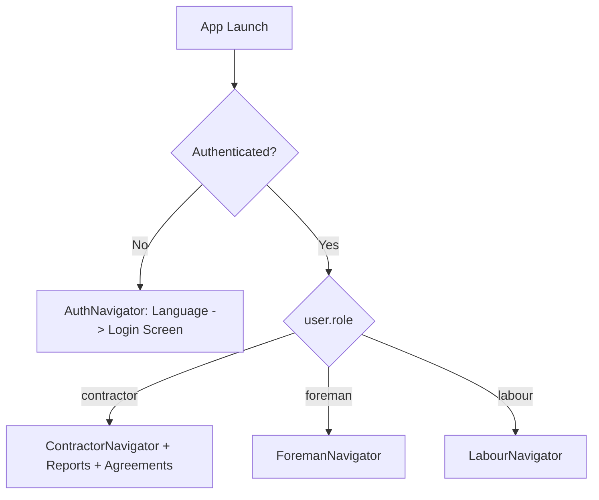

# ConstLabour — Complete Codebase Architecture & Context Guide

> **Target Audience:** AI Coding Assistants (Antigravity, Cursor, Claude, Copilot, ChatGPT) & Human Engineers.  
> **Source of Truth:** Verified directly against local repository files, Git history, Supabase relational migrations, and Edge Functions. Zero hallucinations.

---

## 1. Executive Summary & App Mission

**ConstLabour** (`com.constlabour.app`) is a cross-platform mobile and web application built specifically for the **construction labor ecosystem** (contractors, foremen, and daily-wage laborers).

### Core Problem It Solves
Construction sites typically suffer from disorganized daily attendance, undocumented cash advances, manual and error-prone weekly/monthly wage calculations, lack of formalized worker contracts, and communication barriers across diverse regional languages. 

ConstLabour streamlines this entire lifecycle into a unified digital system:
1. **Multi-Role Access Control (RBAC):** Distinct dashboards and capabilities for Contractors, Site Foremen, and Daily-Wage Labourers.
2. **Site & Workforce Management:** Real-time assignment of workers and foremen to distributed construction sites.
3. **Attendance & Time Tracking:** Daily check-in/check-out, break tracking, automatic calculation of net hours, regular vs. overtime hours, and geo-location logging.
4. **Payroll & Financial Disbursals:** Automatic computation of gross/net wages based on daily rates, mess deductions, advance payments, and payment status tracking.
5. **Worker Employment Agreements:** Digital contracts with touch-screen signature capture (stored securely with audit timestamps and versioning).
6. **Vernacular Onboarding:** Multilingual interface catering to regional workforces (English, Hindi, Marathi, Gujarati, Kannada) with phone OTP and email authentication.

---

## 2. Evolution & Migration History

Understanding this history is critical to avoid re-introducing outdated code patterns:

1. **Origin (Figma Make):**
   - The initial codebase was scaffolded from a Figma Make template (`https://www.figma.com/design/WyoL55rHiv6q5E6VMy1iPh/Constlabour`).
   - The original backend relied on a simulated Deno Key-Value (`kv_store.ts` / `kv_store.tsx`) server inside Supabase Edge Functions.
2. **Migration to Relational PostgreSQL (Completed):**
   - The fragile KV store was deprecated and replaced with a structured PostgreSQL database hosted on Supabase (`project ID: jkwrupxrjbrmuufxetlh`).
   - The complete database schema was executed via `supabase/migrations/001_create_tables.sql` establishing 9 core tables with Row-Level Security (RLS) policies and triggers.
   - An ORM-like data access layer was implemented in `supabase/functions/make-server-689d7d60/db.ts` mapping camelCase TypeScript models to snake_case Postgres columns using the Supabase Service Role client.
   - The API layer in `supabase/functions/make-server-689d7d60/index.ts` was rewritten using Hono (`npm:hono`) to expose RESTful endpoints backed by PostgreSQL.
   - A synchronized mirror of this backend code is kept in `src/supabase/functions/server/` for developer reference.
3. **Build & Platform Stabilization:**
   - **Gluestack Web Crash Fix:** Installed `dom-helpers` to resolve runtime module resolution errors when compiling `@gluestack-ui/core` for the browser.
   - **Chart Rendering Fix:** Injected `yAxisSuffix=""` into `BarChart` props in `ReportsTab.tsx` to prevent canvas drawing exceptions on web.
   - **Type Safety & Navigation Casts:** Fixed TypeScript type-checking errors in `ModernContractorDashboard.tsx` and `BulkAttendanceTab.tsx`.
   - **Mobile LAN/Tunnel Network Isolation:** Bypassed Windows Firewall and Wi-Fi sub-network blocks by running the Metro bundler with `npx expo start --tunnel`.
   - **Expo SDK 58 & React Native 0.88 Compatibility:** React Native 0.88 removed `InteractionManager` from core, causing `@react-navigation/stack` (Card transitions) to throw invariant exceptions. Fixed via a comprehensive polyfill in `src/polyfills.ts` (loaded first in `index.js`) and a persistent `patches/react-native+0.88.0.patch` managed via `patch-package`.

> ⚠️ **CRITICAL RULE FOR AI ASSISTANTS:**  
> Never resurrect `kv_store.ts` or `original_index.ts`. All data mutations and queries must go through the PostgreSQL database helper (`db.ts`) or direct Supabase client methods.

---

## 3. Technology Stack & Key Dependencies

| Layer | Technologies / Libraries |
| :--- | :--- |
| **Mobile & Web Framework** | **React Native** `0.88.0`, **Expo SDK** `^58.0.0`, **React** `19.3.0` |
| **Language & Tooling** | **TypeScript** `~6.0.3` (Strict mode, `@/*` alias to `./src/*`), **Babel**, **Metro** |
| **Styling & Design System** | **NativeWind** `^4.2.1` (Tailwind CSS `^3.4.19`), **Gluestack UI** (`@gluestack-ui/core` `^3.0.12`, `@gluestack-style/react` `^1.0.57`) |
| **Icons** | `@expo/vector-icons` (`MaterialIcons`, `FontAwesome5`, `Ionicons`), `lucide-react-native` `^0.510.0` |
| **Navigation** | `@react-navigation/native` `^6.1.0`, `@react-navigation/stack` `^6.3.0`, `@react-navigation/bottom-tabs` `^6.5.0` |
| **Backend & Cloud** | **Supabase** (PostgreSQL, Supabase Auth, Deno Edge Functions) |
| **Edge Function Framework**| **Hono** `npm:hono` with CORS middleware |
| **Charts & Visualizations** | **react-native-chart-kit** `^6.12.0`, **react-native-svg** `15.16.0` |
| **Form & Input Controls** | `@react-native-community/datetimepicker` `9.2.1`, `react-hook-form` `^7.55.0` |
| **Signature Capture** | `react-native-webview` `14.0.1`, `react-native-signature-canvas` `^4.0.0` |
| **Storage & Notifications** | `@react-native-async-storage/async-storage` `^2.1.0`, `expo-secure-store` `~58.0.2`, `react-native-toast-message` `^2.2.0` |

---

## 4. User Roles & Access Control (RBAC)

The app enforces three roles defined by `UserRole = 'contractor' | 'foreman' | 'labour'`:



### 1. Contractor (`contractor`)
- **Profile:** Master account holder.
- **Capabilities:**
  - Full CRUD on Construction Sites (`SitesTab`).
  - Full CRUD on Foremen (`ForemenTab`) and Workers (`WorkersTab`).
  - Organization-wide Attendance management & bulk attendance marking (`AttendanceTab`, `BulkAttendanceTab`).
  - Payroll calculation, advance payments disbursal, and status tracking (`PayrollTab`).
  - View aggregate analytics (worker skill distribution, weekly attendance curves) via `ReportsTab`.
  - Author and manage employment agreements and review worker signatures (`AgreementTab`).

### 2. Foreman (`foreman`)
- **Profile:** Site supervisor assigned to specific sites by a contractor.
- **Capabilities:**
  - View site-specific dashboard stats (`ForemanDashboard` -> `/foreman/stats`).
  - Mark daily worker attendance (check-in, check-out, break hours, overtime, status) for assigned sites (`AttendanceTab`).
  - View workers assigned to their active site (`ForemanWorkersTab`).

### 3. Labour / Worker (`labour`)
- **Profile:** Field construction worker.
- **Capabilities:**
  - View personal monthly earnings, days worked, present vs. absent days, and pending advance deductions (`LabourDashboard` -> `/worker/stats`).
  - View complete yearly attendance history (`WorkerAttendanceTab` -> `/worker/attendance`).
  - View detailed profile with bank account details, skill level, daily wage, and mess deductions (`WorkerProfileTab`).
  - Prompted with mandatory modal (`WorkerAgreementModal`) if an active contractor agreement requires a new digital signature.

---

## 5. Database Schema & Data Models

All database tables reside in Supabase PostgreSQL under public schema (`001_create_tables.sql`):

### 1. `profiles`
Represents all system users (Contractors, Foremen, Workers).
- `id`: UUID (Primary Key, foreign key to `auth.users(id)` ON DELETE CASCADE)
- `email`: TEXT NOT NULL
- `name`: TEXT NOT NULL
- `role`: TEXT NOT NULL (`'contractor' | 'foreman' | 'labour'`)
- `phone`: TEXT
- `aadhaar_hash`: TEXT (last 4 digits masked hash)
- `bank_details`: JSONB (e.g. `{ "accountNumber": "...", "ifscCode": "...", "bankName": "..." }`)
- `skill_level`: TEXT (`'unskilled' | 'semi-skilled' | 'skilled'`)
- `daily_wage`: DECIMAL(10,2) DEFAULT 0
- `mess_charge`: DECIMAL(10,2) DEFAULT 0
- `contractor_id`: UUID (Self-reference foreign key to `profiles(id)`)
- `site_id`: UUID (Foreign key to `sites(id)`)
- `status`: TEXT DEFAULT 'active'
- `created_at`, `updated_at`: TIMESTAMPTZ

### 2. `sites`
Construction work sites managed by contractors.
- `id`: UUID (Primary Key, DEFAULT `gen_random_uuid()`)
- `contractor_id`: UUID (Foreign key to `profiles(id)` ON DELETE CASCADE)
- `name`: TEXT NOT NULL
- `address`: TEXT
- `start_date`, `end_date`: DATE
- `foreman_id`: UUID (Foreign key to `profiles(id)`)
- `geo_fence`: JSONB
- `status`: TEXT DEFAULT 'active'
- `created_at`, `updated_at`: TIMESTAMPTZ

### 3. `attendance`
Daily labor check-in, check-out, and financial calculations.
- `id`: UUID (Primary Key)
- `worker_id`: UUID (Foreign key to `profiles(id)` ON DELETE CASCADE)
- `site_id`: UUID (Foreign key to `sites(id)` ON DELETE SET NULL)
- `date`: DATE NOT NULL
- `check_in`, `check_out`: TIME
- `break_start`, `break_end`: TIME
- `status`: TEXT (`'present' | 'absent' | 'half-day'`)
- `total_hours`, `break_hours`, `net_work_hours`: DECIMAL(5,2)
- `regular_hours`, `overtime_hours`: DECIMAL(5,2)
- `daily_wage`, `hourly_rate`, `overtime_rate`: DECIMAL(10,2)
- `daily_payment`, `overtime_payment`, `total_payment`: DECIMAL(10,2)
- `geo_location`: JSONB
- `notes`: TEXT
- `marked_by`: UUID (Foreign key to `profiles(id)`)
- `worker_name`: TEXT
- `created_at`, `updated_at`: TIMESTAMPTZ
- **Constraint:** `UNIQUE(worker_id, site_id, date)`

### 4. `advances`
Cash/UPI advance payments given to laborers.
- `id`: UUID (Primary Key)
- `worker_id`: UUID (Foreign key to `profiles(id)`)
- `amount`: DECIMAL(10,2)
- `date`: DATE
- `reason`: TEXT
- `status`: TEXT (`'pending' | 'deducted' | 'cancelled'`)
- `given_by`: UUID (Foreign key to `profiles(id)`)
- `deducted_at`: TIMESTAMPTZ
- `created_at`: TIMESTAMPTZ

### 5. `payroll`
Periodic payroll calculations for sites.
- `id`: UUID (Primary Key)
- `site_id`: UUID (Foreign key to `sites(id)`)
- `start_date`, `end_date`: DATE
- `items`: JSONB (Array of line-item worker calculations)
- `total_gross`, `total_net`: DECIMAL(12,2)
- `status`: TEXT (`'pending' | 'paid'`)
- `created_by`: UUID (Foreign key to `profiles(id)`)
- `created_at`: TIMESTAMPTZ

### 6. `payments`
Actual payment transactions recorded against payroll or individual advances.
- `id`: UUID (Primary Key)
- `worker_id`: UUID (Foreign key to `profiles(id)`)
- `amount`: DECIMAL(10,2)
- `payment_method`: TEXT (`'cash' | 'bank' | 'upi' | 'cheque'`)
- `transaction_ref`: TEXT
- `date`: DATE
- `payroll_id`: UUID (Foreign key to `payroll(id)`)
- `notes`: TEXT
- `status`: TEXT DEFAULT 'completed'
- `created_by`: UUID (Foreign key to `profiles(id)`)
- `created_at`: TIMESTAMPTZ

### 7. `production`
Piece-rate / task-based production unit tracking.
- `id`: UUID, `worker_id`: UUID, `site_id`: UUID, `task_type`: TEXT, `units`: INTEGER, `rate_per_unit`: DECIMAL, `total_amount`: DECIMAL, `date`: DATE, `recorded_by`: UUID

### 8. `agreements`
Employment terms and contracts drafted by contractors.
- `id`: UUID (Primary Key)
- `contractor_id`: UUID (Foreign key to `profiles(id)`)
- `title`: TEXT DEFAULT 'Worker Employment Agreement'
- `content`: TEXT NOT NULL
- `version`: INTEGER DEFAULT 1
- `is_active`: BOOLEAN DEFAULT true
- `created_at`, `updated_at`: TIMESTAMPTZ

### 9. `agreement_acceptances`
Worker signed acknowledgments of agreements.
- `id`: UUID (Primary Key)
- `worker_id`, `contractor_id`, `agreement_id`: UUIDs
- `agreement_version`: INTEGER
- `signature`: TEXT (Digital signature data string)
- `ip_address`, `device_info`: TEXT
- `accepted_at`: TIMESTAMPTZ DEFAULT NOW()

---

## 6. Backend Architecture & REST API Endpoints

The backend is deployed as a single Supabase Deno Edge Function (`make-server-689d7d60`) powered by **Hono**.

- **Base URL:** `https://<PROJECT_ID>.supabase.co/functions/v1/make-server-689d7d60`
- **Active Project ID:** `jkwrupxrjbrmuufxetlh`
- **Authentication:** All requests (except `/health` and `/auth/register`) require an `Authorization: Bearer <JWT>` header containing the Supabase Auth session token.
- **Service Role Admin:** Worker and Foreman accounts are provisioned via `supabase.auth.admin.createUser` to enable direct password-based login without requiring email confirmations.

### Route Catalog

| Category | Method & Path | Description |
| :--- | :--- | :--- |
| **Health** | `GET /health` | Basic status check |
| **Auth** | `POST /auth/register` | Contractor registration (creates Auth user + Profile) |
| | `GET /auth/profile` | Resolves profile details for the authenticated JWT |
| **Workers** | `GET /workers` | Returns all workers under the contractor's organization |
| | `POST /workers` | Provisions a new worker (Auth + Profile with wages/bank) |
| | `PUT /workers/:id` | Updates worker profile, site assignment, or wage |
| | `DELETE /workers/:id` | Cascades deletion across Auth and profiles |
| **Foremen** | `GET /foremen` | Lists foremen with linked site names |
| | `POST /foremen` | Provisions a new foreman user |
| | `PUT /foremen/:id` | Updates foreman details/site assignment |
| | `DELETE /foremen/:id` | Deletes foreman user |
| **Sites** | `GET /sites` | Lists all sites belonging to contractor |
| | `POST /sites` | Creates a new construction site |
| | `PUT /sites/:id` | Updates site details or assigned foreman |
| | `DELETE /sites/:id` | Deletes construction site |
| **Attendance** | `GET /attendance` | Queries attendance with filters (`workerId`, `siteId`, `date`, `startDate`, `endDate`) |
| | `POST /attendance` | Marks attendance record (validates single entry per worker/site/day) |
| | `PUT /attendance/:id` | Edits check-in/out, hours, or status |
| | `DELETE /attendance/:id` | Deletes attendance record |
| **Payroll & Advances** | `GET /payroll` | Retrieves historical payroll summaries |
| | `POST /payroll` | Saves a payroll batch |
| | `POST /payroll/process` | Calculates gross/net wages across date ranges |
| | `PUT /payroll/:id/status` | Sets payroll status (`'pending'` / `'paid'`) |
| | `GET /advances` | Fetches advances (`workerId`, `status`) |
| | `POST /advances` | Records cash/UPI advance to a worker |
| | `PUT /advances/:id/status` | Updates advance status (`'pending'` / `'deducted'`) |
| **Agreements** | `GET /agreements` | Retrieves current active agreement for contractor |
| | `GET /agreement/status` | Worker endpoint: checks if signature is needed |
| | `POST /agreements/accept` | Submits worker touch signature & device metadata |
| | `GET /agreements/acceptances` | Contractor endpoint: lists signed worker agreements |
| **Analytics & Stats** | `GET /dashboard/stats` | Contractor summary: total/active workers & sites |
| | `GET /foreman/stats` | Foreman summary: assigned sites/workers, today's attendance |
| | `GET /worker/stats` | Worker summary: total days worked, month earnings, pending advances |
| | `GET /worker/attendance` | Worker yearly attendance log |
| | `GET /reports` | Aggregated metrics for analytics charts |

---

## 7. Project Directory Structure

```text
Constlabourr/
├── .cursor/                         # Cursor IDE configuration & commands
│   ├── commands/                    # code-review, debug, implement, observe, test
│   └── rules/docs.mdc               # Project documentation rules
├── AppIcons/                        # Platform icons
├── assets/                          # Images, splash, banners, favicons
├── docs/                            # Deep-dive documentation files
│   ├── conventions.md               # Standard app structure & naming conventions
│   ├── formatting.md                # Language, toolchain, styling conventions
│   ├── system_patterns.md           # Architectural patterns & component relationships
│   ├── tech_context.md              # Technical stack & constraints
│   └── testing.md                   # Testing & validation patterns
├── src/                             # Main React Native Frontend
│   ├── App.tsx                      # Root entry component, session init, Gluestack provider
│   ├── index.css                    # Tailwind CSS directives
│   ├── components/
│   │   ├── shared/                  # Common dialogs, Dropdown, FormField, FormModal
│   │   └── ui/                      # Gluestack primitives (box, button, card, input, etc.)
│   ├── context/
│   │   └── AppContext.tsx           # Global authentication context & Supabase instance
│   ├── features/                    # Feature-based domain modules
│   │   ├── agreements/              # AgreementTab.tsx, WorkerAgreementModal.tsx
│   │   ├── attendance/              # AttendanceTab, BulkAttendanceTab, WorkerAttendanceTab
│   │   ├── payroll/                 # PayrollTab.tsx
│   │   ├── profile/                 # WorkerProfileTab.tsx
│   │   ├── reports/                 # ReportsTab.tsx
│   │   ├── sites/                   # SitesTab.tsx
│   │   └── workers/                 # WorkersTab, ForemenTab, ForemanWorkersTab
│   ├── navigation/                  # React Navigation setup
│   │   ├── AppNavigator.tsx         # Gateway mapping user.role -> Navigator
│   │   ├── AuthNavigator.tsx        # LanguageSelection -> Login
│   │   ├── ContractorNavigator.tsx  # Bottom tab navigator for contractor
│   │   ├── ForemanNavigator.tsx     # Bottom tab navigator for foreman
│   │   └── LabourNavigator.tsx      # Bottom tab navigator for worker
│   ├── screens/                     # High-level screens
│   │   ├── ContractorDashboard.tsx  # ModernContractorDashboard
│   │   ├── ForemanDashboard.tsx     # ModernForemanDashboard
│   │   ├── LabourDashboard.tsx      # ModernLabourDashboard
│   │   ├── LanguageSelectionScreen.tsx
│   │   ├── LoginScreen.tsx          # Phone OTP & Email authentication
│   │   └── SettingsScreen.tsx       # Profile, Language, App Lock, Logout
│   ├── styles/globals.css           # Global CSS variables
│   ├── supabase/functions/server/   # Mirrored local copy of Edge Function code
│   └── utils/supabase/info.tsx      # Supabase URL and anon key configuration
├── supabase/                        # Official Supabase configuration & deployment
│   ├── functions/
│   │   └── make-server-689d7d60/    # Production Hono Edge Function (index.ts, db.ts)
│   └── migrations/
│       └── 001_create_tables.sql    # Master SQL migration file for PostgreSQL
├── .env                             # Local environment variables
├── .env.example                     # Environment template
├── app.config.js                    # Expo configuration (slug, bundle ID, splash)
├── babel.config.js                  # Babel presets and '@/' module resolver
├── eas.json                         # EAS build profiles (preview, production)
├── metro.config.js                  # Metro bundler config with NativeWind
├── package.json                     # NPM dependencies & scripts
├── PRIVACY_POLICY.md                # Comprehensive data & privacy disclosure
├── README.md                        # Quickstart documentation
└── tailwind.config.js               # Tailwind design system tokens & colors
```

---

## 8. Development & Deployment Workflows

### 1. Environment Variables
Create a `.env` file in the root directory:
```bash
EXPO_PUBLIC_SUPABASE_URL=https://jkwrupxrjbrmuufxetlh.supabase.co
EXPO_PUBLIC_SUPABASE_ANON_KEY=<YOUR_SUPABASE_ANON_KEY>
SUPABASE_SERVICE_ROLE_KEY=<YOUR_SUPABASE_SERVICE_ROLE_KEY>
```

### 2. Starting the App
- **Web Browser:**
  ```bash
  npm start
  ```
  Press `w` to open `http://localhost:8081`.  
  *Tip:* If the browser displays a blank screen or stale cached bundles, open DevTools (`F12`), right-click the browser reload button, and click **"Empty Cache and Hard Reload"**.
- **Mobile Device (Expo Go):**
  ```bash
  npx expo start --tunnel
  ```
  Scan the generated QR code using Expo Go on Android or the Camera app on iOS. The tunnel avoids LAN/firewall connection failures (`java.io.IOException: Failed to download remote update`).
- **Clearing Bundler Cache:**
  ```bash
  npx expo start -c
  ```

### 3. Deploying Supabase Edge Functions
Whenever modifying files in `supabase/functions/make-server-689d7d60/`:
```bash
npx supabase functions deploy make-server-689d7d60 --no-verify-jwt
```
*Note:* Always copy updated backend files to `src/supabase/functions/server/` to keep local mirrors in sync.

### 4. Standalone Android APK Generation
Without an EAS cloud account:
1. Generate the native Android workspace:
   ```bash
   npx expo prebuild --clean
   ```
2. Open the newly generated `android/` directory in **Android Studio**.
3. Select `Build` > `Build Bundle(s) / APK(s)` > `Build APK(s)`.

---

## 9. Golden Rules for Future AI & Human Contributors

1. **Relational Database Integrity:** Always query and modify data through `db.ts` or PostgreSQL tables. Do not create client-side localStorage or KV store substitutes for persistent entities.
2. **Field Mappings:** Keep `map*` and `unmap*` mappers synchronized in `db.ts` whenever adding columns to database tables (e.g., camelCase in React Native <-> snake_case in Postgres).
3. **Chart Props on Web:** Always pass `yAxisSuffix=""` to any `react-native-chart-kit` component to prevent web SVG crashes.
4. **Preserve NativeWind / Gluestack Compatibility:** Do not delete `dom-helpers` from `package.json` — it is an essential runtime peer dependency for Gluestack web overlays.
5. **Path Aliases:** Always use `@/` for imports within `src/` (e.g., `@/components/ui/box`, `@/context/AppContext`).
